



<a href="https://github.com/Mystic0112/Maquina-de-Shorts"></a>
<a href="https://github.com/Mystic0112/Setup-de-ia"></a>

<a href="https://github.com/Mystic0112/GSH-Desktop"></a>
<a href="https://mystic0112.github.io/Landpage-for-me/"></a>



<a href="mailto:c9hesky@gmail.com"></a>
<a href="https://wa.me/qr/AQTLGHIWAIEUE1?s=v"></a>
<a href="https://mystic0112.github.io/Landpage-for-me/"></a>

